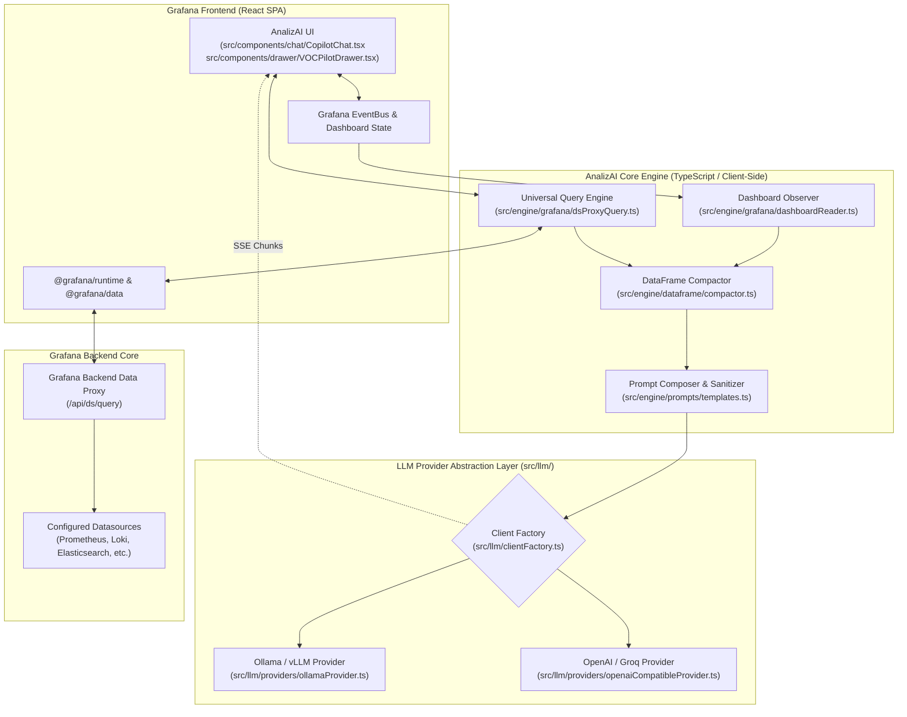

# AnalizAI Plugin - Architecture Specification

> **Project:** AnalizAI / VOCPilot (*Universal Observability & NOC Copilot for Grafana*)  
> **Architecture Version:** 2.0.0  
> **Compatibility:** Grafana 10.x / 11.x  

---

## 1. System Overview & Objectives

**AnalizAI** (also known as **VOCPilot**) is an advanced Grafana plugin designed to act as an AI-powered operational copilot and automated Root Cause Analysis (RCA) engine. 

Unlike traditional monitoring extensions tied to a single telemetry store or proprietary vendor cloud, AnalizAI is **fully datasource-agnostic**. It leverages Grafana's internal `DataFrame` pipeline and unified `/api/ds/query` backend proxy to inspect metrics, logs, and traces directly from whatever data sources are already configured in the Grafana workspace (Prometheus, Loki, Elasticsearch, Zabbix, MySQL, etc.).

---

## 2. Architecture & Data Flow Diagram

---

## 3. Core Components & Directory Structure

### 3.1. Dashboard Observer (`src/engine/grafana/dashboardReader.ts`)
* **Mechanism:** Subscribes to Grafana panel and dashboard lifecycle events via `@grafana/runtime`.
* **Benefit:** When an operator is viewing an active dashboard, AnalizAI inspects the time-series and log data already loaded in memory without issuing redundant queries to underlying databases.

### 3.2. Universal Query Engine (`src/engine/grafana/dsProxyQuery.ts`)
* **Mechanism:** For telemetry outside the current viewport, requests are routed through Grafana's native `/api/ds/query` backend proxy.
* **Advantage:** Inherits all built-in Grafana authentication, RBAC permissions, and secure network routing. No direct out-of-band database access is required from the user browser.

### 3.3. DataFrame Compactor & Synthesizer (`src/engine/dataframe/compactor.ts`)
* **Challenge:** Raw time-series payloads containing thousands of data points exceed LLM token limits and increase latency.
* **Compaction Pipeline:**
  1. **Type Inspection:** Separates numeric metric fields from unstructured log strings.
  2. **Descriptive Statistics:** Computes `min`, `max`, `avg`, `p95`, initial-to-final delta, and rate of change.
  3. **Spike Detection:** Identifies anomalies exceeding standard deviation thresholds ($\ge 2.5\sigma$) and flags precise anomaly timestamps.
  4. **Log Aggregation:** Groups repeating log messages, computes frequency histograms, and highlights critical keywords (`ERROR`, `FAIL`, `DENY`, `TIMEOUT`, `OOM`).

### 3.4. LLM Provider Layer (`src/llm/`)
* Completely decoupled from any single vendor SDK.
* Implements a unified interface for streaming chat completions:
  * **Ollama / vLLM Provider:** Direct local inference for air-gapped or privacy-strict environments.
  * **OpenAI Compatible Provider:** Integration with Groq, OpenAI, or compatible gateways.
  * **Client Factory:** Dynamic instantiation based on workspace settings and user preference.

---

## 4. Security & Compliance

1. **Secure Credential Storage:** API tokens and sensitive endpoints are stored using Grafana's encrypted `secureJsonData` mechanism.
2. **Data Sanitization:** Automatic redaction of sensitive identifiers, tokens, and PII from telemetry payloads before prompt assembly.
3. **Read-Only Operation:** AnalizAI functions exclusively as an observational assistant and diagnostic advisor. No mutating actions are performed against underlying datasources or infrastructure without explicit human execution.
